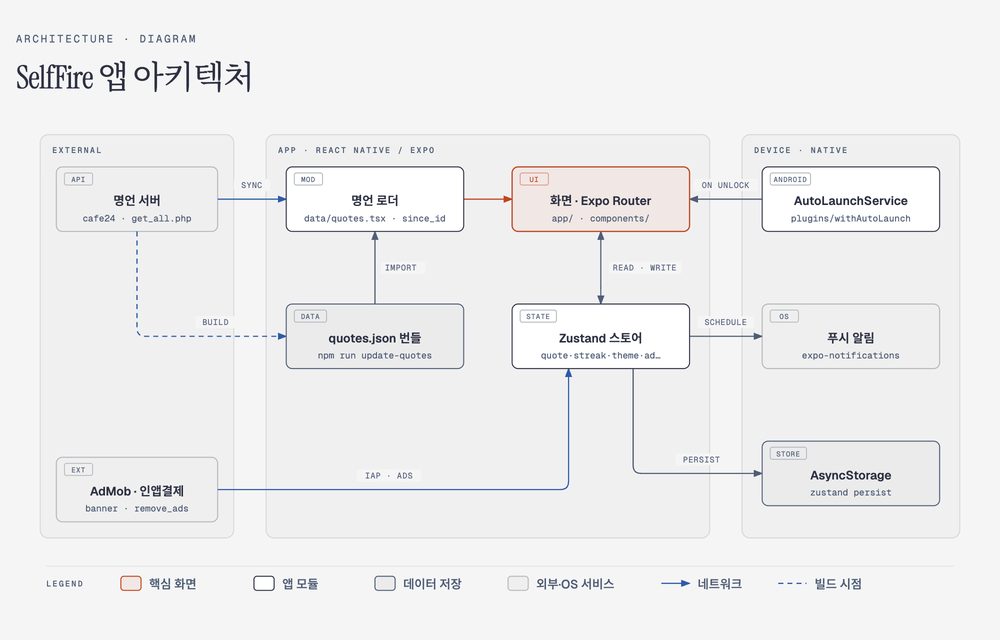

# SelfFire (셀프파이어) 🔥

SelfFire는 좋은 문장대로 살게 해 주는 앱입니다. 오늘 따를 문장을 고르고, 그 문장대로 할 일 한 가지를 해내면 불씨를 지핍니다.

## ✨ 주요 기능

* **오늘 할 일 한 가지 (핵심)**: 명언을 넘겨 보다가 '오늘 이 문장대로 살기'로 오늘 따를 문장을 고르고, '오늘 이 문장대로 할 일 정하기'로 할 일 한 가지(60자)를 정합니다. 홈은 그 문장과 할 일에 머물러 하루 동안 보며 도전받게 하고, 해낸 뒤 '완료'를 누르면 불씨를 점화합니다(Hold to Ignite). 완료 전까지는 문장과 할 일을 바꿀 수 있고, 완료하면 그날 기록으로 굳습니다. 불씨는 명언을 연 날이 아니라 문장대로 해낸 날에 켜집니다. 해낸 일들은 사이드바와 '나의 모닥불' 시트에서 따른 문장과 함께 볼 수 있습니다.
* **명언 제공 및 즐겨찾기**: 다양한 동기부여 명언을 확인하고, 마음에 드는 명언을 즐겨찾기에 추가할 수 있습니다.
* **나만의 명언 작성**: 사용자 본인만의 명언이나 다짐을 직접 작성하고 관리할 수 있습니다.
* **스트릭 (연속 달성) 기능**: 할 일을 해내고 불씨를 지핀 날이 이어질수록 모닥불이 커집니다.
* **커스텀 폰트 지원**: 나눔명조, 고운돋움, 주아체, 나눔펜스크립트 등 다양한 한국어 폰트를 지원하여 감성적인 UI를 제공합니다.
* **꾸미기**: 사이드바의 '꾸미기'에서 앱 테마(라이트/다크 등), 명언 카드 배경, 글꼴, 홈 화면 위젯 모양을 바꿀 수 있습니다.
* **푸시 알림**: 잊지 않고 동기부여를 받을 수 있도록 리마인드 알림을 제공합니다.

## 🛠 기술 스택

* **Framework**: React Native, [Expo](https://expo.dev/)
* **Routing**: [Expo Router](https://docs.expo.dev/router/introduction) (File-based routing)
* **State Management**: [Zustand](https://github.com/pmndrs/zustand) (AsyncStorage를 활용한 기기 내 데이터 영구 저장)
* **Styling**: [@shopify/restyle](https://github.com/Shopify/restyle)
* **Language**: TypeScript
* **Monetization**: Google AdMob (`react-native-google-mobile-ads`)
* **Push Notifications**: Expo Notifications

## 🚀 시작하기 (Getting Started)

1. **패키지 설치**
   ```bash
   npm install
   ```

2. **앱 실행**

   ```bash
   npx expo start
   ```

   실행 후 터미널에 나타나는 QR 코드를 통해 다음 방법으로 앱을 확인할 수 있습니다:
   - **Expo Go** 앱을 통한 실제 기기 테스트
   - **Android Emulator** 실행 (`a` 입력)

## 🤖 Android 네이티브 프로젝트 관리

`android/` 폴더는 저장소에 커밋되어 있고 **이 폴더가 Android 빌드의 기준**입니다. 폴더가 있으면 EAS 빌드는 `expo prebuild`를 건너뛰고 이 폴더를 그대로 씁니다.

* R8·리소스 축소, Crashlytics proguard 규칙, AD_ID 권한, 미디어 권한 제거, arm64 전용 빌드, gradle 메모리 설정은 `android/`에 직접 들어 있고 `app.json`으로는 다시 만들 수 없습니다. **`npx expo prebuild --clean`을 실행하면 이 설정이 사라지므로 실행하지 마세요.**
* `app.json`의 Android 관련 설정(scheme, 권한, config plugin 등)을 바꾸면 같은 내용을 `android/`에도 직접 반영해야 합니다.
* 네이티브 라이브러리(예: `react-native-mmkv`, `react-native-nitro-modules`)는 autolinking으로 연결되므로 `android/`를 고칠 필요는 없지만, 추가·업데이트한 뒤에는 개발 빌드를 다시 만들어야 합니다.
* 버전 코드는 EAS 원격 버전 관리(`eas.json`의 `appVersionSource: remote`, `autoIncrement`)가 빌드할 때 정하므로 `app.json`에 적지 않습니다.

## 🧪 테스트와 빌드

* `npm test`: Jest + React Native Testing Library 단위·화면 테스트. PR마다 CI(`.github/workflows/ci.yml`)가 lint·타입 검사와 함께 돌립니다.
* `npm run e2e`: [Maestro](https://maestro.mobile.dev) E2E 흐름(`.maestro/`). 에뮬레이터나 기기에 개발 빌드 또는 preview 빌드를 설치한 뒤 실행합니다. 첫 흐름이 앱 데이터를 지우고 시작합니다.
* EAS 빌드: GitHub Actions의 **EAS Build** 워크플로를 수동 실행하거나 `v*` 태그를 푸시하면 Android 빌드를 맡깁니다. 저장소 Secrets에 `EXPO_TOKEN`이 필요합니다.

## 🏗 아키텍처

<picture>
  <source media="(prefers-color-scheme: dark)" srcset="docs/architecture-dark.png">
  
</picture>

* **명언 데이터**: 빌드 시 `npm run update-quotes`로 서버의 전체 명언을 `data/quotes.json`에 번들하고, 실행 중에는 `since_id` 이후의 새 명언만 동기화합니다.
* **상태 관리**: 화면은 Zustand 스토어를 읽고 쓰며, 스토어는 `persist`로 MMKV(`utils/storage.ts`)에 저장되고 알림 스토어가 푸시 알림을 예약합니다. 예전 버전이 AsyncStorage에 남긴 값은 처음 실행할 때 MMKV로 옮깁니다.
* **잠금 해제 자동 실행 (Android)**: `plugins/withAutoLaunch.js`가 네이티브 `AutoLaunchService`를 생성해 잠금 해제 시 앱을 띄웁니다.

> 다이어그램 원본은 [`docs/architecture.html`](docs/architecture.html)입니다.

## 📁 주요 프로젝트 구조

```text
self-fire/
├── app/                  # Expo Router 기반 화면(Screen) 및 레이아웃 폴더
│   ├── (navi)/           # 메인 화면들
│   ├── add-quote.tsx     # 나만의 명언 추가 모달 화면 (/add-quote)
│   ├── customize.tsx     # 꾸미기: 테마·카드 배경·글꼴·위젯 꾸미기 (/customize)
│   ├── deed.tsx          # 오늘 이 문장대로 할 일 작성 모달 (/deed)
│   ├── favorites.tsx     # 저장한 문장 목록·검색 화면 (/favorites)
│   ├── history.tsx       # 해낸 일 기록 화면, 달별 (/history)
│   ├── my-quotes.tsx     # 내 명언 목록 화면 (/my-quotes)
│   ├── settings.tsx      # 설정 화면 (/settings)
│   ├── privacy.tsx · terms.tsx # 개인정보 처리방침 · 이용약관
│   └── _layout.tsx       # 최상위 레이아웃 (폰트 로드, 테마, 전역 래퍼)
├── assets/               # 이미지, 아이콘 등 정적 리소스
├── components/           # 재사용 가능한 UI 컴포넌트
├── hooks/                # 화면 로직 훅 (명언 넘기기, 앱 생명주기 등)
├── services/             # 여러 스토어를 엮는 일 (앱 시작 초기화, 알림 예약, 오늘의 명언 후보)
├── models.tsx            # 공통 데이터 모델 및 타입 정의
├── store/                # Zustand 스토어 (quote, streak, theme, font 상태 관리)
├── plugins/              # Expo 커스텀 앱 플러그인
├── app.json              # Expo 프로젝트 메타데이터 및 설정 파일
└── package.json          # 패키지 의존성 관리 파일
```
